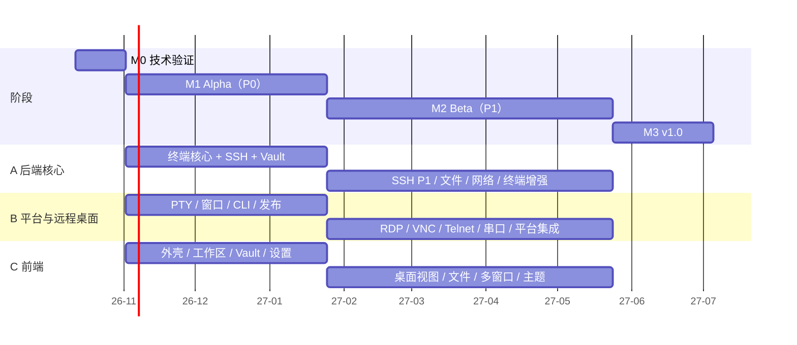

# 开发计划（v1.0）

> 范围：[features.md](../product/features.md) 中全部 P0 和 P1 功能（ADR-022：内嵌 RDP/VNC 属于 v1.0）。
> 本计划以功能 ID 为单位拆解，issue、PR 和测试用例都引用同一编号。每个里程碑结束时复盘一次，并更新本文件。

> **当前交付进度**：以 [§15 动态交付清单](#15-动态交付清单与当前进度) 为准。下文日期／人力仍是原计划假设，不是已经完成的证据；详细验收日志见 [validation.md](./validation.md)。

## 1. 前提与假设

| 项 | 假设 |
|---|---|
| 团队 | 3 名全职工程师：**A** 后端核心（终端、SSH、文件、网络、存储）；**B** 平台与远程桌面（PTY/ConPTY、窗口与系统集成、RDP/VNC、构建发布）；**C** 前端（界面外壳、各类视图、设置与主题）。另有兼职设计师（Logo、界面评审）和项目负责人（范围、商标、证书、发布决策） |
| 开始日期 | 2026-10-12（周一）。周次 W1 = 2026-10-12 当周 |
| 迭代 | 每 2 周一个迭代（Sprint），每个迭代结束时做一次可运行的演示 |
| 估算口径 | 以“人周”计，**包含**单元测试、互通测试和三平台适配；不含假期 |
| 假期 | 元旦（W12）、春节（W18 整周停工）、清明（W26）、劳动节（W29–W30）。除春节外，其余假期所在的迭代按 80% 产能安排 |
| 开发机器 | 每人至少能使用一台 Windows、一台 macOS（Apple Silicon）和一台 Linux 桌面机（可以是虚拟机）；另备一台 Windows Server 用于 RDP 测试，并配置自托管 CI |

## 2. 总体时间线

| 阶段 | 周次 | 日期 | 产出 |
|---|---|---|---|
| **M0 技术验证** | W1–W3 | 2026-10-12 → 10-30 | S1–S21 结论；仓库骨架和 CI；做出是否切换方案的决定 |
| **M1 Alpha** | W4–W15（Sprint 1–6） | 2026-11-02 → 2027-01-22 | 0.1.0 Alpha：全部 P0，内部日常使用 |
| **M2 Beta** | W16–W32（Sprint 7–14，W18 春节） | 2027-01-25 → 05-21 | 0.5.0 公开 Beta：全部 P1，功能冻结 |
| **M3 v1.0** | W33–W38（Sprint 15–17） | 2027-05-24 → 07-02 | 1.0.0 正式版 |



## 3. 工作量与产能

| 阶段 | 估算（人周） | 产能（人周） | 结论 |
|---|---|---|---|
| M0 | 约 9 | 9 | 平衡 |
| M1（P0） | 约 35 | 36（扣除元旦后约 35） | 偏紧。Sprint 6 是加固迭代，可以吸收少量延误 |
| M2（P1） | 约 52 | 48（扣除清明和劳动节后约 46） | **超出约 6 人周**。用下方的“弹性项”调节 |
| M3 | 约 15 | 18 | 留有余量，用于 Beta 反馈和弹性项 |
| **合计** | **约 111** | **约 108** | 需要通过弹性项保住 1.0 日期 |

**弹性项**：属于 P1，但可以顺延到 M3；如果 M3 也放不下，就移到 v1.1，不影响 1.0 发布。
`WS-06` 下拉终端 · `LOCAL-06` “在此处打开” · `CLI-04` Shell 补全 · `UI-07` 中除 VS Code / Windows Terminal 之外的导入格式 · `TERM-12` 通知 · `SSH-10` 连接后动作 · `VAULT-10` 连接历史 · `RDP-07` 中的图片剪贴板

**不可削减的核心**：终端核心、SSH、Vault、SFTP、端口转发、内嵌 RDP（RDP-01~06、08）、内嵌 VNC、字符编码、Shell 集成、会话恢复、安全类功能（SEC-*）。

## 4. M0 技术验证（W1–W3）

| 周 | A | B | C |
|---|---|---|---|
| W1 | 仓库骨架（workspace、xtask、lints、cargo-deny）；**S2** 快照重放和内存测量 | **S1 / S13** Channel 吞吐（三平台，含本机 WebSocket 对比）；CI 矩阵 | 前端骨架（Vite、React、Tailwind、Radix 色板）；**S21** tauri-specta |
| W2 | **S2** 续：宽度一致性、查询应答屏蔽；**S4** russh 兼容性矩阵 | **S14** IronRDP 兼容性；**S3 / S10** ConPTY | **S15** noVNC 对接；**S7** 输入法和字体 |
| W3 | **S18** Route 组合；**S5** CLI 通信；**S11** 会话与窗口解耦 | **S6** 窗口材质；**S17** 系统快捷键捕获；**S9 / S12** | **S16** H.264 直通；汇总各项结论 |

- **S8（Wasm 插件）和 S19（Mosh）** 只影响 P2，M0 不做，推迟到 v1.1 计划时再验证。S20 已取消。
- **W3 结束时做决定**（参与人：负责人 + A/B/C）：
  - S1/S13 在 Linux 上不达标 → 桌面画面改走本机 WebSocket；如果仍不达标，Linux 上的远程桌面默认使用独立原生窗口；
  - S2 不达标 → 缩小热区或改用 `vt100`，并更新 ADR-001；
  - S14 缺失的功能 → 确认由外部客户端（RDP-08）兜底的清单；
  - S21 不可用 → 改用 ts-rs，并定稿 ADR-018。
- **同期启动的非研发事项**（负责人）：商标检索和域名；**申请代码签名证书和 Apple Developer 账号**（周期长，必须在 W1 启动）；内置字体选型；设计师开始设计 Logo。

## 5. M1 Alpha（W4–W15，Sprint 1–6）

| Sprint | 周次 | A 后端核心 | B 平台 | C 前端 | 演示标准 |
|---|---|---|---|---|---|
| 1 | W4–5 | `pulse-core`、`pulse-ipc`（帧编解码 + 样例）、`pulse-term` actor 与 EchoTransport 跑通整条链路 | `pulse-pty` + Shell 自动探测（LOCAL-01）、Profile（LOCAL-02）、随附 ConPTY（LOCAL-03）、登录 shell 和环境变量刷新 | `ipc/` 层、模拟后端、设计 token（Radix）、最简版 TermView | 三平台都能打开本地 shell 标签并正常交互 |
| 2 | W6–7 | 发送额度和落后处理、快照、查询应答（ADR-026）、历史热区（TERM-05/06）；用 vttest 和常见程序验证 VT 兼容性（TERM-02） | 自绘标题栏和窗口材质（UI-02/04）、单实例、CLI 通信服务骨架 | 标签与分屏树、ViewHost、快捷键服务、复制粘贴、输入法、字体（TERM-01/03/04/07/08） | 分屏；视图释放后恢复内容；`cat` 1GB 的门禁进入 CI |
| 3 | W8–9 | `pulse-ssh` 认证、known_hosts、Agent；`pulse-route` 直连和 SSH 跳板（SSH-01/03/04、NET-01 的 P0 部分） | `pulse-store`：SQLite schema、迁移、凭据加密、钥匙串、设置分层（VAULT-04、SEC-01） | Vault 列表/树、主机和入口编辑器、快速连接、连接过程中的弹窗（VAULT-01/02/03/05） | 用保存的身份经跳板连上 SSH 主机 |
| 4 | W10–11 | ssh_config 导入和实时读取（SSH-05、VAULT-09 P0）、历史冷区 | Capability 注册表、CLI P0 命令、`PULSE_PANE_ID`（CLI-01、SEC-05） | 命令面板、由 schema 生成的设置页、主题（UI-01）、多语言（UI-05）（WS-01/02） | `pulse ssh prod`、`pulse split -v` 可用 |
| 5 | W12–13 | 把非功能指标的基准测试接入 CI（启动、内存、回显）并优化；日志脱敏（SEC-06） | 安装包、签名和自动更新流水线（REL-01/02） | 标签管理（WS-09）、键盘无障碍和对比度保护（UI-06）、界面打磨 | 通过 release 流水线产出三平台的签名安装包，并能自动更新 |
| 6 | W14–15 | 加固：全员排查 bug、修复三平台差异、开始内部日常使用 | 同左 | 同左 | **发布 0.1.0 Alpha** |

**M1 退出标准**：
- 全部 P0 功能都满足完成标准（§10）；
- features.md §18 的非功能指标全部纳入 CI，其中启动时间、内存、`cat` 1GB 三项达标；
- 团队成员用 PulseTerm 作为日常主力终端至少一周，没有遗留的 P0 级 bug。

## 6. M2 Beta（W16–W32，Sprint 7–14）

| Sprint | 周次 | A 后端核心 | B 平台与远程桌面 | C 前端 | 演示标准 |
|---|---|---|---|---|---|
| 7 | W16–17 | SSH P1：连接复用、保活与重连、睡眠和网络事件、Agent 转发、旧算法、PPK（SSH-02/06/07/08/09） | `pulse-rdp` 连接与会话、位图和 RemoteFX 解码、帧发送管线（RDP-01） | RemoteCanvas（WebGL）、扫描码映射、输入采集（RDP-04） | 内嵌显示并操作 Windows Server 桌面 |
| — | W18 | **春节** | | | |
| 8 | W19–20 | `pulse-fs`：Vfs、SFTP、传输队列（FILE-02） | RDP：NLA、证书确认、剪贴板、动态分辨率（RDP-02/03/07、SEC-03） | 双栏文件面板、传输队列面板（FILE-01） | 双栏 SFTP 上传下载大文件，支持断点续传 |
| 9 | W21–22 | 远程文件编辑、跟随终端目录、拖入上传（FILE-03/04/05）；Shell 集成后端（SHELL-01/02/03） | 系统快捷键捕获（三平台）、RDP 工具栏、外部客户端启动器（RDP-05/06/08） | 桌面工具栏（DesktopChrome）、VncView 与 ChannelSocket 适配层 | RDP 功能完整；SFTP 跟随终端目录 |
| 10 | W23–24 | 完整的 Route（含 ProxyCommand）、端口转发与状态面板后端（NET-01/02/03） | VNC 后端传输（VNC-01/02）、Telnet、串口（PROTO-01/02） | 转发规则界面、搜索界面、命令标记显示（VNC-03） | VNC 经 SSH 隧道连接；连接串口设备 |
| 11 | W25–26 | 全量搜索、会话日志、字符编码、终端行为选项（TERM-09/16/17/18） | win32-input-mode、提权实例、“在此处打开”（LOCAL-04/05/06） | 多窗口和标签跨窗口移动、会话恢复、广播输入（WS-03/04/05） | 连接 GBK 编码的设备；重启后恢复布局（清明，80% 产能） |
| 12 | W27–28 | Vault P1 后端（VAULT-06/07/08/10）、主密码与应用锁（SEC-02） | 下拉终端、CLI P1、URL 协议、OSC 52 与链接安全（WS-06、CLI-02/03/04、SEC-08/09） | Vault P1 界面、片段库、密钥管理、终端不透明度、主题导入（UI-03/07） | 分组继承；从 VS Code 主题导入配色 |
| 13 | W29–30 | 加密导出导入、恢复默认（SYNC-01/03）、崩溃报告（REL-03） | 互通测试矩阵全部变绿；修复 S14 列出的 RDP 兼容问题 | 链接、自动滚底、通知（TERM-10/11/12）、高风险操作确认（SEC-04） | 功能基本齐全（劳动节，80% 产能） |
| 14 | W31–32 | **功能冻结**；全员修 bug；确认弹性项的去向 | 公开 Beta 的发布准备 | 用户文档站点和应用内帮助（REL-05） | **发布 0.5.0 公开 Beta** |

**M2 退出标准**：
- 除弹性项外，全部 P1 完成；
- 互通测试矩阵全部为绿色：OpenSSH 多版本、dropbear、交换机（旧算法 + GBK）、xrdp、Windows Server 2016–2025、TigerVNC、macOS 屏幕共享、telnetd、虚拟串口；
- RDP 1080p 办公场景达到非功能指标；
- 完成一次内部安全评审（凭据、IPC 接口、远端终端内容的处理）。

## 7. M3 v1.0（W33–W38，Sprint 15–17）

| Sprint | 周次 | 内容 |
|---|---|---|
| 15 | W33–34 | 处理 Beta 反馈；完成弹性项（按用户反馈排优先级）；性能优化 |
| 16 | W35–36 | 发布 RC 版本；第三方许可证审计（THIRD_PARTY.md、字体、主题、ConPTY）；无障碍检查；升级和数据迁移演练（从 0.1 / 0.5 升级） |
| 17 | W37–38 | 只修阻塞发布的问题；完善文档和发布说明；**发布 1.0.0（2027-07-02 前后）** |

**v1.0 发布标准**：
- 连续 2 周没有新增 P0 / P1 级 bug；
- Beta 用户中崩溃率 < 0.5%（以用户主动开启的崩溃报告统计）；
- 非功能指标全部达标；
- 文档覆盖全部 P0 / P1 功能。

## 8. 关键路径与依赖

```
S1/S13 数据通道结论 ──► pulse-ipc 帧格式 ──► 终端核心（Sprint 1–2）──► SSH（Sprint 3）──► SFTP / 端口转发 / Shell 集成（M2）
S2 快照结论 ──► ViewHost / 会话恢复 / 多窗口
S14 IronRDP 结论 ──► RDP 管线（Sprint 7）──► RDP 完整功能（Sprint 9）
pulse-store（Sprint 3）──► Vault 界面 ──► 所有需要凭据的协议
代码签名证书（W1 申请）──► 签名流水线（Sprint 5）──► Alpha 发布
```

- **最长的一条工作线是 B 的 RDP**（Sprint 7–9，约 8–10 人周）。如果 Sprint 8 结束时 RDP 进度落后超过一个迭代，就把 VNC 后端（VNC-01/02）改由 A 负责，Telnet 和串口移到 Sprint 11。
- 前端不等后端：C 在 `ipc/mock` 上先做界面，前后端的接口在每个 Sprint 的第一天定下来（先提交类型定义和模拟实现）。

## 9. 风险与应对

| 风险 | 可能性 | 影响 | 触发信号 | 应对 |
|---|---|---|---|---|
| Linux WebKitGTK 的 IPC 吞吐或输入法不达标 | 中 | 高 | S1/S13/S7 不通过 | 改用本机 WebSocket；桌面画面改用独立原生窗口；必要时把 Linux 列为二级支持平台 |
| alacritty_terminal 内存或接口不满足需求 | 中 | 中 | S2 不通过 | 缩小热区；改用 `vt100`；或维护一个小补丁 |
| IronRDP 功能缺口或兼容性问题 | 中 | 中 | S14 清单；Sprint 7–8 实测 | 由外部客户端兜底；向上游提交修复（IronRDP 是 MIT/Apache，可以贡献） |
| 代码签名证书或 Apple 账号延迟 | 中 | 高 | W8 时仍未拿到 | W1 就启动申请；Alpha 可以先在内部发未签名版本 |
| M2 范围超过产能 | 高 | 中 | 任一 Sprint 完成率 < 80% | 顺延弹性项；在 v1.0 发布前不接受任何新增的 P0/P1 需求 |
| ConPTY 随附加载失败 | 低 | 中 | S10 不通过 | 在 `pulse-platform` 中自己封装加载 |
| 关键人员不可用 | 中 | 高 | — | 每个 crate 都有第二负责人（§11）；设计和决定都写进文档和 ADR |
| 商标检索发现冲突 | 低 | 高 | M0 检索结果 | M1 之前改名（到时只是批量替换前缀），公开仓库和域名在检索完成前不对外宣传 |

## 10. 完成标准（Definition of Done）

一个功能 ID 只有满足以下全部条件才算完成：
1. 在三平台上都能工作（功能表中标明不支持的平台除外），并在各平台上至少人工验证过一次；
2. 测试满足 guide.md §5 的最低要求；涉及协议的功能要进入互通测试矩阵；
3. 没有导致 CI 中的性能门禁退化；
4. 界面文字有中文和英文；可以用键盘操作；相关操作已登记到 Capability（可以从命令面板调用）；
5. 用户文档已更新；如果改动了 IPC、数据库 schema 或 action id，PR 中已说明兼容性影响；
6. 日志中没有敏感信息。

## 11. 分工与负责人

| 模块 | 主负责人 | 第二负责人 |
|---|---|---|
| pulse-core、pulse-ipc、pulse-term、pulse-ssh、pulse-route、pulse-fs、pulse-tunnel | A | B |
| pulse-store、pulse-cap、pulse-app | A | C |
| pulse-pty、pulse-platform、pulse-telnet、pulse-serial、apps/cli、apps/desktop、xtask、CI 与发布 | B | A |
| pulse-desktop、pulse-rdp、pulse-vnc | B | C |
| ui/ 全部 | C | B |
| 互通测试环境（tests/interop） | A | B |
| 用户文档 | C | 全员 |

第二负责人负责该模块的代码评审，在主负责人缺席时接手。

## 12. 节奏与管理

- **连续实施与进度回写**：按 §15 的优先顺序跨模块连续实施，不在小模块完成后例行等待确认。只在重大架构／产品选择、需要授权的依赖／平台资源或真实阻塞时请求用户决策。每次验收后同步 §15 的状态、剩余项与证据链接，并更新相关架构／功能／开发或用户文档；不得仅追加探针日志或以测试数估算完成百分比。
- **任务管理**：用 GitHub Projects。每个功能 ID 对应一个 issue，按里程碑归类；标签包括模块（`term`、`ssh`、`rdp`…）、阶段（`P0`/`P1`）、`elastic`（弹性项）。
- **例会**：每天 15 分钟同步；Sprint 开始时做计划并定下当期的前后端接口；Sprint 结束时演示并复盘；里程碑结束时更新本计划和 ADR。
- **版本节奏**：`main` 分支每晚构建（nightly）；M1 后半段起每周发一个内部 alpha；M2 结束后每两周发一个公开 beta。
- **仓库公开时间**：建议在 M1 Alpha 发布时公开仓库（前提是商标检索已完成），同时准备好 `CONTRIBUTING.md` 和 `SECURITY.md`。
- **范围变更**：新增需求一律先进入 P2 待评估。确实需要提升为 P0/P1 时，由负责人决定，并同时指定一个等量的弹性项移出。

## 13. 人员变化时的调整

| 团队规模 | 调整方式 | v1.0 预计时间 |
|---|---|---|
| 2 人（后端 1 + 前端兼平台 1） | A 和 B 的工作合并；RDP 整体推迟到 SFTP 和端口转发之后；弹性项全部移到 v1.1 | 约 2027-11 |
| 3 人（本计划） | — | 2027-07 初 |
| 4 人（加 1 名前端或全栈） | 新增的人负责文件面板、Vault P1 界面和用户文档；C 专注于工作区和桌面视图 | 约 2027-05 底（提前 4–5 周，考虑了新人熟悉和沟通成本） |

## 14. v1.0 之后（概要）

| 版本 | 方向 | 主要功能 |
|---|---|---|
| v1.1（2027 Q3） | 远程桌面增强 | RDP-09~13（网关、音频、H.264、独立窗口、`.rdp` 文件）、VNC-04、RDP-07 文件剪贴板、未完成的弹性项 |
| v1.2（2027 Q4） | 协议与文件 | Mosh（PROTO-03，需先做 S19）、FTP（FILE-07）、X11 转发、Zmodem/trzsz、系统 OpenSSH 模式（SSH-11/12/13）、FILE-06、VAULT-09 其余导入器 |
| v1.3（2028 Q1） | 同步与扩展 | 端到端加密同步（SYNC-02）、Wasm 插件（EXT-01，需先做 S8）、MCP（EXT-02、CLI-06）、CLI-05、WS-07/08 |
| 之后 | 视反馈而定 | TERM-13/14/15、SEC-07、REL-04、P3 各项 |

## 15. 动态交付清单与当前进度

本节将功能规格、原里程碑与当前实现分开对照，作为后续连续实施和进度回写入口。功能 ID 仍以 features.md 为准，阶段与弹性项不变。**当前为 M1 的部分产品化阶段，尚未达到 Alpha**；M0 三平台、S2 和依赖等门禁也未封板。不按日历推定已进入 Beta，不把技术探针或已存在的 crate 当完整功能完成。

### 15.1 当前状态与验收口径

**当前为 M1 Alpha 的部分产品化阶段，未达到 Alpha。** 下表只记录最新范围，不能用原始排期或累计测试数换算完成比例。“已接通，待验收”表示产品入口已存在且有直接行为／组件检查；“Linux 限定验收”只覆盖记录中的真实环境，不表示三平台完成。满足 §10 才能登记整个功能交付。

当前状态以本节为准；旧批次原文及证据索引移至 [交付历史](plan-history.md)，详细成功／失败记录保留在 [validation.md](validation.md)。历史表中的“尚待”不能覆盖后续专项证据；未复现的关闭崩溃和回收超时继续列为未定位。

| 工作包 | 最新状态 | Alpha 主要剩余范围 |
|---|---|---|
| LOCAL-01～03：本地终端与 Profile | Linux 自动发现、参数／目录／环境、登录参数与原生回收已有实窗证据；独立 UUID 自定义 Profile 的创建／复制／编辑／隐藏／删除／恢复、统一默认及 GUI／CLI 已接通；存储、真实 PTY、23 项组件及独立进程重开／显式批准／刷新／退出的 Linux 实窗通过 | Windows Shell／WSL 与 macOS 发现、权限、启动与兼容；三平台默认及输入／性能集中验收 |
| WS-01～03：标签、分屏与会话 | Linux 标签、嵌套分屏、布局调整、刷新保活及自然结束只读恢复已有实窗证据；当前两PTY分屏／比例方向模式已校准并复验通过，覆盖显式折叠、55%跨方向保留、焦点关闭与四PTY／两GUI退出 | 重负载、多屏 DPI、三平台；跨窗口拖标签与重启布局恢复按对应阶段继续 |
| VAULT-01～05、SSH-01～03：身份与连接 | 已存 Ed25519 与 NIST ECDSA P-256／P-384／P-521 的 OpenSSH、明文／有界加密 PKCS#8 PEM 已接收、解析、加密保存；ECDSA 格式和真实 loopback SSH 的 headless 开发矩阵已通过。Linux 生产 WebView／真实 SSH 已覆盖密码、交互 MFA，以及私钥／软件 Agent／密码三类联合认证：保存直连、临时目标明确选择与成功后可选保存、CLI 冷暖原窗口批准、保存路线每跳明确选择；按各项收据核对实际部分成功、原页／Vault代际、来源变化、取消／错误回答无回退、刷新不重认证及物理回收。密码联合最新三跳证据为两条成功路线、20条连接与15条通道全部退出；完整 App SSH 372项、文档35项和适配器8项回归通过。详细范围见15.2及各项验收记录 | 软件 RSA 受 RUSTSEC-2023-0071 阻断，不启用漏洞后端或豁免；其他密钥格式待补；系统／硬件 Agent、外部 PAM／企业 MFA、外部网络与跨平台；连接复用仍受 HOL 门禁约束 |
| HOST-01～07：目录与组织 | 主机／SSH 入口／身份、组、标签、收藏、最近、ssh_config 导入及保存入口别名已接通，核心 Linux 使用链已有证据 | 其他继承字段管理、更多导入兼容、跨平台；组织元数据与连接／凭据权限继续分离 |
| CLI-01、SEC-05/06：CLI 与多窗口 | Linux 冷暖启动、本地／保存 SSH 入口、分屏、顺序命令链、精确选窗与 SSH 跨窗已有本地限定验收；`--interactive`、`--key-interactive` 和 `--agent-interactive` 分别经过明确方法、原页／epoch 捕获、冷暖原窗口批准、问答取消／CLI 断开、终端刷新恢复及 native 排空。Agent 联合真实软件 Agent／SSH 已验证四次所选签名、两次成功、两次取消和四条物理连接退出，未选钥匙零签名，配置／密文保持不变；`--password-interactive` 已通过原捕获／冷暖批准／问答、批准前零密码认证、两次成功、刷新及四连接／四GUI退出原生矩阵；58项前端、28项CLI、9项许可、5项密码授权回归与生产严格Clippy通过 | Windows／macOS IPC 与权限、完整异常压力；历史关闭 SIGSEGV 未定位；外部企业 MFA／硬件 Agent |
| TERM-04/08：字体与格子 | 字体／后备／连字、字号、行高和字距已有 Linux 限定实窗验收；默认仍14px；正式字体入口已迁移私有构建／当前UI；1倍／2倍受控缩放矩阵通过，物理窗口翻倍、四组列数一致，150%行高存在SDK设备像素取整的一行差异；高DPI CSS字距换算已修复，预设／后备／继承恢复、刷新／重开及六会话退出通过，CI共用组合任务 | CJK 完整矩阵、系统 IME、真实多屏移动、硬件GPU、三平台、性能 |
| TERM-05/06：历史与查找 | 最多十万行有界冷热历史、分页、主／备用／结束文本查找、软换行、正则／整词与快捷键入口已有开发检查；Linux 生产 WebView／PTY 已通过历史／主屏、备用屏、自然结束查找、大小写／整词／正则、双向定位及零输入泄漏，修复 End ACK 后误撤销读取绑定；冷区行定位改为块索引，同机 release 十万行完整字面扫描约 51～53ms 降至 24～25ms（后端单次均值）；新增主动停止查找，保留当前页并等待在途读取退出后放行新查询，27 项相关回归与 Chrome 受控 IPC 交互通过，独立真实十万行PTY双向停止保页、重新查询、EOF只读及零输入已通过Linux生产实窗，正式任务已接CI；停止观测335.09／251.79ms含AT-SPI开销，不计p95；SSH 中文跨软换行、硬换行隔离、组合字符原文保留及自然 EOF 后只读查找已通过生产实窗，零输入与重新认证 | 十万行内存及搜索延迟、三平台 |
| TERM-09～12/16～18：终端交互 | 滚动、可视响铃、网页／IP:端口／文件路径检查、Linux 受限浏览器打开、TERM／按键及 Profile／组／入口覆盖已接通；较早剪贴板链已有 Linux 实窗证据；默认输入／输出滚动、鼠标／键盘返回最新、BEL合并清除与刷新静默已通过生产WebView／真实PTY，修复滚轮与绘制核验竞争，三条会话退出；普通网页／IP:端口／OSC8真实目标、Unix带空格文件路径及行列、含账号目标拒绝和GTK剪贴板回读已通过同一原生链，零额外PTY输入与工作区导航；Linux GIO经隔离默认处理器打开实际图形Chrome本机HTTP页面、重复抑制与正常退出已通过；显式滚动开关的明确保存／旧视图保持、同PTY刷新、CLI继承和恢复默认已通过两PTY原生矩阵；SSH鼠标／键盘返回零输入、显式输入回底已通过原五连接矩阵；SSH五批后台输出保位／跟随、两个显式开关保存／同会话刷新／恢复默认与任务实际结束也通过 | 其他默认浏览器／HTTPS／网络环境、外部编辑器、其他行为与平台打开能力；完整范围见 15.3 |
| UI-01、终端外观：设置与主题 | 界面浅／深／系统、五种界面强调色、十套终端配色、21 组设置保存／恢复已接通；新增跟随系统分别指定深浅终端主题，以整组策略保存。全局、Profile、直属组／SSH 入口共用目录与继承，固定作用域覆盖优先；设置分类／搜索／焦点和快捷键返回已接通。Linux 实窗已通过 Backspace／Delete、TERM、预设前景色与历史容量保存重开、同会话刷新、旧会话冻结及新建 GUI／CLI 继承，三条原生会话全部退出；Profile 按键／前景色的 GUI／CLI 覆盖、冻结／重开及恢复继承已通过，五条原生会话退出；SSH 全局／直属组／入口远端 PTY TERM、按键与前景色优先级、逐级恢复继承、旧会话冻结和刷新不重连已通过，五条 SSH 连接与 GUI 全部退出；Linux 隔离原生桌面门户的系统配色跟随、明确覆盖、保存／刷新／独立重开和恢复继承均通过，两次GUI与提供方退出；原生系统终端深浅策略矩阵发现Linux新会话读取旧门户缓存的问题，GTK通知快照修复通过18项设置回归、严格Clippy和五PTY／双窗口矩阵；原五项UI外观也复验通过，暖CLI两次原窗口批准及系统深浅选色已通过版本3五PTY矩阵；冷CLI深浅两次独立启动已通过版本4七PTY／四窗口矩阵；SSH系统深浅、组／入口固定覆盖及冻结已通过版本6五连接矩阵、14次远端OSC与五轮像素；GNOME／KDE及跨平台仍待验 | 其他设置及 Profile／组／SSH 其他字段、GNOME／KDE实际桌面外观切换与辅助技术验收；UI-03 不透明度／UI-07 导入继续按 P1 排序 |
| WS-01/02：命令面板与键盘 | 固定目录扩充为 17 项，新增快捷键、组织、私钥、Agent、快速连接、导入、两种分屏与会话复制；复制按当前页面记录的 Profile 来源重开，来源不明时禁用并提示，不猜测目标；中英文检索共用文案，原键位配置范围保持封闭，旧页／原目标变化拒绝执行。Linux 真实 WebView 返回链通过；命令面板复制在两条实际 PTY 上通过（来源回执、独立 PID、画面与退出）；关闭会话前确认新增 `confirm_close`（默认开），`false` 时免确认关闭并即时回收已通过同一原生链 | 三平台物理键位冲突、辅助技术与系统 IME；通用执行目录按后续范围推进 |
| UI-02/04/05/06：平台界面 | 用户层语言保存／恢复、工作区框架、设置、快捷键、面板及当前管理／连接弹窗已接双语；终端历史查找、链接、粘贴／CLI 确认、响铃和返回最新输出已接入，保留用户内容；终端已知失败增加固定中英文原因与恢复建议，单窗格／分屏／CLI 复用，输入不确定时明确提示不重复发送。完整 UI-05 验收仍开放；**UI-02 专指窗口材质，终端配色不使用该编号** | 真实系统菜单、其余错误可读性核对、原生故障注入与双语辅助技术；平台材质与降级、Snap／原生菜单及跨平台验收 |
| REL-01/02：发布与交付 | 构建／CI 基础、审计执行、778 组件工作区署名及候选目标依赖审查已有 | 实际发行内容与系统动态库、三平台安装包／签名／公证、更新与系统代理；发布门保持阻断 |

### 15.2 Alpha 连续实施顺序

按完整工作包推进入口、持久化、重新读取／恢复和实际使用链，优先功能开发。每批保留类型、编译和直接行为检查；若干相关能力齐备后集中原生验收，避免每个开关重复全量回归、SSH 矩阵与大规模归档。

本轮优先按下表收敛 Alpha；下方既有功能包表保留详细进度。P1 细项仅在阻塞 P0 主链时提前处理。

| 工作包 | 退出条件 | 当前状态／阻塞 |
|---|---|---|
| 可复现源码基线 | 独立终端优化、工作区功能和交付文档分组签名提交；正式 check／test／probe 与独立审计归档 | `110aa9e`／`008661b`实现提交签名有效；整体check／test／probe通过；SSH探针全特性及生产配对严格检查通过，原54项探针可达性告警已限定处理，审计8项许可／5项维护仍阻断；收据见`target/probes/alpha-convergence/baseline.json` |
| Windows／macOS 最小生产链 | 后端发现与保存 Profile→批准启动→输入／尺寸→刷新→物理退出；存储权限及 IPC；Windows Shell／WSL／ConPTY、macOS 登录模式 | 已在私有 Rust 1.95.0／MinGW 环境通过 Windows GNU 的 pulse-store／pulse-pty／pulse-app 基础与全特性全目标源码检查，修正仅适用于 Unix 的持久化／Shell 测试注册；正式 check-core-features 已接入三平台 CI，Linux 111项受影响回归和宿主正式入口通过，Windows安全存储与生产链仍未验收。Windows 目录基础原语已在既定 pulse-platform 层实现：真实进程 SID／受保护 DACL、祖先句柄、重解析点拒绝与复核；尚未接入生产存储，Windows 文件级 ACL／链接检查、有界读取和排他新建已实现但尚未原生运行，精确快照／目录级锁／源句柄原子替换基础层已实现但尚未原生运行，Windows设置快照／类型化编辑适配候选已接独立验证入口，生产设置／Profile接入仍待完成，原生测试尚待 Windows 运行。私有Wine10已运行39项平台测试（20通过／19失败），目录保护位创建后回读丢失已由独立Win32反例复现，未放宽准入；Wine不计Windows实机通过。宿主仅 Linux、仓库无 remote，Windows／macOS 实际构建运行资源仍阻塞，交叉编译不计原生验收 |
| 最新 release 性能 | 重测空窗／单会话／十万行／20标签整进程；<120MB／<250MB／历史增量≤20MB；1GB输出的100ms中断、回显p95<16ms及冷启动 | 内存335.53MB／471.99MB／历史增量82.90MB均未达标（内存候选：前端只保留可视区与短回滚，更早历史按需走后端分页，消除前后端重复保存；空窗约285MB固定成本不受影响）；真实cat 1GiB于267.63秒完成、Ctrl+C退出41.0ms通过。真实100次回显p95为58.75ms未达16ms，输入5.72ms／输出54.27ms，临时取证的原生发送前p95仅0.25–0.33ms，DOM变更行候选三轮无稳定收益已撤回；新增100组页面阶段关联：队列／解析／准备／核验p95各约1ms，双帧等待30ms、首帧至像素42.84ms（分布重叠、1ms时钟量化）；普通release对照p95为59.71ms仍失败，临时取证已移除，帧调度／呈现仍待定位（两帧屏障不在像素路径上：xterm自行按RAF绘制，屏障只延后ACK与下一帧处理；探针在像素变化后再停20ms才按下一键，上一帧屏障早已结束，缩短屏障不会改善该p95，未做对照构建；Windows 11／RTX 2080 Ti／144Hz 实机对照包已改为直接使用WebView2 Runtime、不依赖Edge浏览器；用户单轮WT60Hz数据仅参考，用户144Hz单轮WT/DOM p95为28.294/28.927ms（差0.633ms），WebGL中途无标记仍失败；独立诊断包待实机执行，不代表完整PulseTerm延迟通过）；Linux新进程启动六次输入／退出完成，已有配置到可输入参考中位1288.07ms（含选择和观测），Mac／Windows启动门禁仍待实机；原输出未清屏尾部网格已在独立release构建中于1GiB后Equal（264.43秒），本轮中断10.22ms／IFQ零额外输入／原生退出通过；首轮177.26ms失败保留；追加20次中断中位18.81ms／p95 31.19ms／最大32.54ms均小于100ms，仍不关闭偶发延迟调查；隐藏解析器／全部历史一致性及硬件／跨平台仍开放 |
| P0 系统交互与稳定性 | 系统 IME／DPI／字体／粘贴／外观／辅助技术；原生故障定位、关闭 SIGSEGV 与回收超时调查 | Linux专项及隔离原生门户外观已有证据；1x／2x受控GTK缩放、字体网格／继承／六会话退出通过，高DPI字距已修复；72次关闭（48次未决时序）正常，历史SIGSEGV／启动黑窗未定位，诊断构建已捕获构建／页面初始化超时，24轮阶段／PID／实际退出关联通过，页面确认／CLI展示无限等待已加前端五秒恢复边界并通过62项回归与Chrome受控检查，原生迟到回执／明确刷新两场景通过生产WebView／真实PTY及两GUI退出，独立验证feature和正式任务已接CI；原生故障根因／修复仍开放；GNOME／KDE桌面、真实IBus／libpinyin的候选零输入、取消、选词单次提交、刷新及精确字节／进程退出已通过，修复WebKit未配对结束重复提交并通过1543项前端回归；IBus预编辑适配已修复候选偏位，三轮候选／窗口移动／精确字节及退出通过；箭头残留在独立GTK也复现，严格弹窗门禁仍失败；Fcitx原窗口光标跟随已修复，四候选／严格隐藏／精确字节／刷新和退出通过，已接独立CI入口，IBus共享矩阵复验通过；窗口移动旧坐标在GTK也复现，完整几何门禁仍失败；当前界面剪贴板开关／继承与迟到读取三场景通过，旧视图冻结／恢复继承／三份最终输入及三PTY／GUI退出已核对；Tauri／API稳定补丁已更新至2.12.4，真实SDK异常投递和Linux分屏／剪贴板使用链通过，历史故障不据此关闭；其他系统输入法、多屏及其余平台开放 |
| 发布合规与安装更新（并行） | 依赖策略及完整文本、实际发行审查、安装／签名／公证／更新 | 许可拒绝已清零（用户批准项目保持MIT，八项精确版本例外已启用，在线审计0许可拒绝）；5项维护公告、21项完整文本缺口、MPL可执行分发的源码获取渠道及平台／签名资源仍阻断 |

已有功能包的详细进度：

| 索引 | 工作包 | 当前推进与交付目标 |
|---|---|---|
| 1 | 设置、主题与界面语言 | **全局、Profile 与 SSH 按键／配色的 Linux 使用链已通过，剩余集中验收继续**：分类／搜索／焦点、五种强调色、十套内置配色、系统深浅策略和作用域继承已接通；全部当前管理／连接与终端专用弹窗使用中英文消息，切换保留用户数据、草稿与焦点。按键字节、TERM／预设前景色／历史容量的显式保存重开、刷新与冻结／新会话继承已通过；Profile 按键／前景色的 GUI／CLI 覆盖、原会话冻结与恢复继承，以及 SSH 全局／直属组／入口远端 PTY TERM、按键与配色覆盖、逐级恢复、旧会话冻结和五连接退出已通过；终端已知失败的双语恢复建议、分屏原因保留及浏览器呈现已验证。Linux原生门户的外观五段使用链及两次窗口退出已通过；GNOME／KDE实际桌面外观、其他 Profile／组／SSH 字段及其他设置、其余错误可读性、原生故障注入、系统菜单与双语辅助技术仍开放。UI-07 导入按 P1 推进 |
| 2 | 命令面板与键盘操作 | **16 项开发链及 Linux 集中返回链已通过**：复用原入口与授权，分屏绑定原两个会话；中英文名称／检索、焦点返回与旧页失效已接通。保留原键位闭合范围，继续三平台冲突、系统 IME 和辅助技术验收 |
| 3 | 本地 Profile 与 SSH 明确缺口 | **自定义 Profile、直接与保存路线逐跳 MFA／私钥联合的 Linux 使用链已通过，ECDSA 格式与真实 SSH 开发链已通过**：独立 UUID、生命周期、默认选择、真实 PTY 及 GUI／CLI 原页批准／启动／回收已验证。Ed25519 与三种 NIST ECDSA 格式及加密保存／实际 SSH 已接通；保存路线允许每跳明确选择 MFA，保留角色限制、原页／epoch、挑战及取消排空，生产 WebView／三跳 SSH 合成已有九段收据。软件 RSA 因未修复漏洞阻断，不用 Agent 或其他认证回退代替。临时目标 MFA 的撤销、两轮认证及可选保存已有六段实窗收据；直连保存／临时目标的明确“私钥 + MFA”已通过十段实窗、原点击／epoch、实际部分成功门禁、终端恢复及七条连接排空；CLI 独立私钥联合的原捕获、冷暖明确批准、取消／断开及四条 native 连接排空已通过生产实窗；逐跳私钥联合的十五段实窗覆盖混合／全联合、逐层取消／错答、来源变化零回答、配置／密文不变及父／叶／通道全部退出。GUI 保存直连 Agent + MFA 已通过十一段生产实窗，覆盖保存指纹唯一签名、来源变化零回答、配置／密文不变及八条连接退出；CLI Agent + MFA 的冷暖两轮、四次唯一签名、刷新和四条物理退出已通过生产实窗；三跳密码／Agent 联合转发／Agent 联合叶终端已通过六项实窗检查、四次所选指纹签名及成功／取消链排空；临时目标 Agent 联合已通过直接回归与生产严格检查，扩展 GUI 实窗共十四项检查、四条成功会话及十一条连接退出，覆盖取消零写、暂不保存刷新与精确已有目标保存复用；保存直连密码 + MFA 已通过12项生产实窗检查、两次成功会话与九连接退出，覆盖普通密码不升级、第一因子拒绝／完整成功／缺少MFA、取消／错答／来源变化零回答、输入及刷新不重认证；原页／代际／固定期限3项回归、56项前端回归与生产严格检查通过，完整共享授权369项／35项文档测试及适配器1项协议门禁单测通过；临时密码联合已通过独立来源准备、明确选择与注册后可选保存验收，类型／双语及57项前端、4项授权生命周期、8项共享适配器回归与生产严格Clippy通过；扩展15项实窗覆盖保存／临时四条成功会话、暂不保存刷新、明确保存复用已有目标及十二连接全部退出；保存直连CLI密码联合已通过冷暖批准、取消／断连、两轮MFA、刷新和四连接排空，以及58项前端、28项CLI、9项许可、5项密码授权和严格生产检查；逐跳密码联合开发链已接入冻结hop转换、独立路由准备、每跳明确方法和中间／叶两类适配器，6项密码授权回归通过，79项前端、类型／双语和生产全目标严格检查通过，6项正式三跳原生通过，两条路线、20条连接和15条通道退出；完整共享372项／35项文档测试和8项适配器回归通过；剩余继承与平台范围继续推进，不把 loopback 证据当成外部 MFA 或跨平台完成 |
- 临时新目标的首次指纹与新建保存已通过Linux原生验收：身份表单新增独立只读核对入口，不自动认证，路线继续逐跳核对。修复嵌套Escape误取消父表单，以及共享直连MFA下一轮先于答案回执到达时误取消。类型／双语、60项客户端协议／生命周期及完整1530项前端回归通过。版本3实窗19项检查通过：首次核对取消零写、独立信任保存零认证、精确新增一条主机、原记录／凭据不变、刷新和独立重连；6次联合成功、14次密码认证、9条远端回显、16条连接和两个GUI实际退出0。最终材料见 `target/probes/workspace-password-interactive/accepted/bdac59a7/`；企业／系统Agent与跨平台仍待验。

| 并行 | 平台与性能基础 | Linux真实WebView已测整进程PSS／RSS、十万行留存和20标签退出。最新归档release基线为单会话335.53MB、20标签471.99MB、十万行增量82.90MB，三项均未达标；旧333／463／65MB基线仅保留对照。后端冷历史索引扫描约快2.1倍，变长日志冷区分配7.95MB降至5.58MB；这些局部收益不等于整进程达标。有界Data合并后真实cat 1GiB于267.63秒完成、Ctrl+C退出41.0ms通过，但完整前后端状态一致性仍待验；100次回显p95为58.75ms未达16ms。Linux新进程已有配置到可输入参考中位1288.07ms，含选择与观测，不替代Mac／Windows门禁。1倍／2倍受控DPI通过，真实硬件／多屏／系统IME及三平台仍开放。最新内存收据 `target/probes/workspace-performance/post-convergence.json`，负载／回显见15.2 |
| 集中验收 | 近期终端与设置能力 | 全局按键／TERM／预设前景色／历史容量的 GUI／CLI 新旧会话链，以及历史／主屏／备用屏／自然结束查找已通过 Linux 生产 WebView／PTY，三条原生会话全部退出；Profile 覆盖与恢复继承的五会话链、SSH 全局／直属组／入口的远端 PTY TERM、按键与前景色覆盖及逐级恢复的五连接链也已通过；SSH 历史跨软换行、硬换行隔离及自然 EOF 后查找已通过；默认滚动／返回与响铃原生链已通过；链接／Unix路径检查与真实GTK复制回读也已通过；Linux GIO到图形Chrome的本机HTTP交接与退出已通过；显式滚动开关的两PTY设置／刷新／CLI继承／恢复默认链已通过，精确输入abc／xyz且两PTY及GUI回收；SSH鼠标／键盘返回零输入与显式输入回底也已通过五连接原生链；SSH后台输出与显式开关的五段保存／刷新／恢复及输出任务退出也通过；继续其他默认浏览器及网络环境、其他行为覆盖、系统 IME／DPI／跨平台 |
| 独立门禁 | 发布合规 | 保留 8 项许可证／5 项维护策略问题（本次新增 zbus 系列三项维护公告）、22 项完整文本缺口及实际发行审查；不让来源调查持续挤占功能主线，也不放宽门禁 |

P0 范围闭合后，再推进 SFTP 等后续完整产品模块。RDP／VNC 仍属既定 v1 必交付，不因当前 Linux 终端／SSH 成熟而移出范围。
### 15.3 M2–M3 P1 剩余交付

| 工作包 | 当前基础／缺口 | 产品完成目标 |
|---|---|---|
| FILE-01～05：SFTP | 尚无完整文件工作台 | 双栏、路径／书签／虚拟列表、传输队列与断点续传、拖拽上传、内／外部编辑、目录跟随 |
| NET-01 P1、NET-02/03 | HTTP/SOCKS/SSH Route 真实验证已有，产品规则未交付 | 所有协议可组合路由及 ProxyCommand；本地／远程／动态转发、规则保存、重连、状态／连接数／流量面板 |
| RDP-01～08 | 尚无完整内嵌产品，仍是 v1 必交付 | 认证／证书、位图/RemoteFX、RemoteCanvas、输入与快捷键、缩放/DPI、剪贴板、工具栏及外部客户端兜底；真实 Windows/xrdp 矩阵 |
| VNC-01～03 | 尚无完整内嵌产品，仍是 v1 必交付 | 认证、隧道、画质／缩放、剪贴板和只读交互；真实服务端矩阵 |
| PROTO-01/02：Telnet／串口 | 尚无完整产品入口 | 协商／自动登录；参数／回显／hex、设备拔插与实际／虚拟设备验证 |
| SSH-02/06～10 | 证书／软件 Agent／旧算法／压力 probe 已有 | PPK、生产连接复用／保活／重连／睡眠网络事件、Agent 转发、按主机旧算法与连接后动作；shared-connection HOL 仍为复用门禁 |
| SHELL-01～03 | Bash 固定脚本、OSC133 解析/receipt已有 | cwd 跟踪、各 Shell 自动注入／远端安装、命令跳转／复制输出／失败标记 UI；安全隔离与真实启动文件兼容 |
| TERM-09～12/16～18 | 保留历史、主屏／备用屏及自然结束文本已支持字面／正则／整词查找与入口；[输入回底](../architecture/terminal-input-scroll.md)、[输出回底与手动返回](../architecture/terminal-output-scroll.md)、[窗格可视响铃](../architecture/terminal-bell.md)及[HTTP／HTTPS、IP:端口链接识别、检查、复制与Linux受限系统打开](../architecture/terminal-links.md)及含空格的完整引号绝对文件路径检查／复制已接通；[macOS Option／Meta全局设置](../architecture/terminal-option-meta.md)已接通保存、恢复与视图选项，待实窗验收；[Backspace DEL／BS全局选择](../architecture/terminal-backspace.md)已接通保存恢复、v10投影及可信普通按键改码，默认DEL；[TERM／Delete与Profile行为覆盖](../architecture/terminal-behavior.md)已接通全局TERM选择、Delete CSI／DEL、Profile Option／Backspace／Delete稀疏覆盖与单次保存，v11投影及本地／SSH冻结启动配置；[分组／SSH入口行为覆盖](../architecture/terminal-scoped-behavior.md)已接通统一编辑、逐项继承、源版本冲突检查与GUI／CLI直连及跳板叶终端应用，SSH按键偏好随会话冻结并用于刷新恢复 | 外部编辑器打开、Windows／macOS链接系统打开、声音／系统通知／后台未挂载响铃、日志、编码选择与生产binary/Zmodem预分类、CR／LF等其他终端行为设置、祖先组叠加及其他作用域字段原生／跨平台验收待补 |
| WS-03～06 | 窗口迁移／刷新授权基础已做 | 真正跨窗口拖标签、重启后布局恢复（不是原 PTY 生存承诺）、广播输入及确认、下拉终端 |
| VAULT-06～08/10、SEC-02～04/08/09 | 分层／主密码原语／剪贴板禁止基础已有 | 密钥管理、继承 UI、Snippet、连接历史、生产应用锁／高风险确认、OSC52 写入审批、链接确认 |
| UI-03/07、LOCAL-04～06、CLI-02～04 | 主题导入、CLI 传输等基础已做 | 生产主题库/不透明度、Win32 input／提权／系统菜单、其他协议命令／URL注册／补全；原弹性项照 §3 管理 |
| SYNC-01/03、REL-03/05 | 尚未完整产品化 | 加密备份导入导出、范围化恢复默认、默认关闭且脱敏的崩溃报告、中文英文用户文档／帮助／更新说明 |

P2/P3 仍按 §14 排后：Mosh、录制／内联图片、插件、MCP/AI、端到端同步等不抢占 Alpha 主线。RDP/VNC 不因缺实现而擅自移到后续版本。

### 15.4 验收阻塞与回写规则

保持显式阻塞：三平台真实支持、S2 不可表示／分歧状态、系统 IME、跨屏 DPI、高负载拖拽／多会话与进程树清理；启动／整棵 WebView 内存／10 万行历史／cat 1GB／回显等性能目标；Profile 和既有可见性／绘制超时；当前 8 项许可证拒绝＋5 项维护公告（含 interprocess 带入的 doctest-file／recvmsg 0BSD，未放宽许可策略）；notify 许可批准、代码签名与发布资源。按当前可用工具执行类型／编译检查；语言服务Unknown或超时不算通过，不擅自安装语言服务。

每个工作包完成一次验收后必须：
1. 更新本节“当前状态”和“剩余交付”，附具体环境、入口、证据与不覆盖项；未满足 §10 时保持“已接通，待验收”，不勾选整个功能完成。
2. 更新 validation.md 的直接行为与失败记录；修复不得回写原失败为通过，独立复验与原组合结果区分。
3. 同步实际受影响的架构/ADR、功能规格、mise/CI、开发指南、用户说明和接口／迁移兼容说明；不为了更新进度重复运行无变化测试或降低门禁。
4. 遇到真实阻塞，先完成不依赖该阻塞的计划工作；需要用户决策时说明选项、影响和建议，其他情况下继续下一功能，不进行例行小模块确认。
