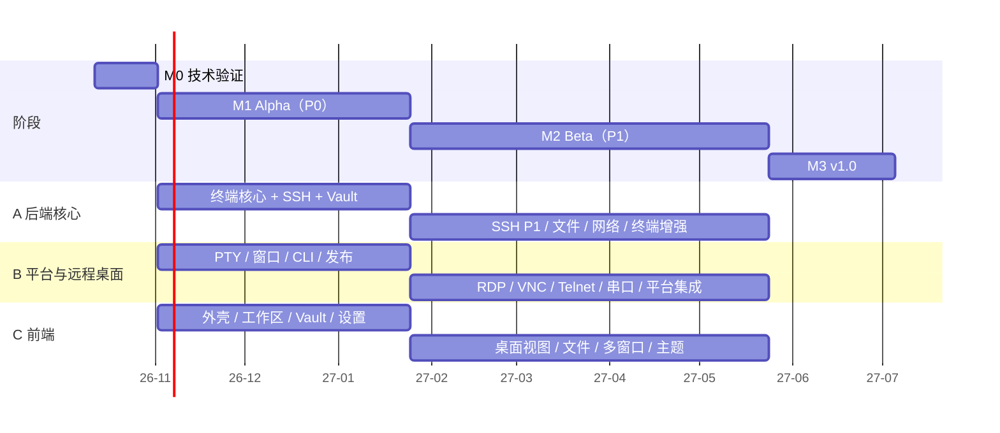

# 开发计划（v1.0）

> 范围：[features.md](../product/features.md) 中全部 P0 和 P1 功能（ADR-022：内嵌 RDP/VNC 属于 v1.0）。
> 本计划以功能 ID 为单位拆解，issue、PR 和测试用例都引用同一编号。每个里程碑结束时复盘一次，并更新本文件。

## 1. 前提与假设

| 项 | 假设 |
|---|---|
| 团队 | 3 名全职工程师：**A** 后端核心（终端、SSH、文件、网络、存储）；**B** 平台与远程桌面（PTY/ConPTY、窗口与系统集成、RDP/VNC、构建发布）；**C** 前端（界面外壳、各类视图、设置与主题）。另有兼职设计师（Logo、界面评审）和项目负责人（范围、商标、证书、发布决策） |
| 开始日期 | 2026-10-12（周一）。周次 W1 = 2026-10-12 当周 |
| 迭代 | 每 2 周一个迭代（Sprint），每个迭代结束时做一次可运行的演示 |
| 估算口径 | 以“人周”计，**包含**单元测试、互通测试和三平台适配；不含假期 |
| 假期 | 元旦（W12）、春节（W18 整周停工）、清明（W26）、劳动节（W29–W30）。除春节外，其余假期所在的迭代按 80% 产能安排 |
| 开发机器 | 每人至少能使用一台 Windows、一台 macOS（Apple Silicon）和一台 Linux 桌面机（可以是虚拟机）；另备一台 Windows Server 用于 RDP 测试，并配置自托管 CI |

## 2. 总体时间线

| 阶段 | 周次 | 日期 | 产出 |
|---|---|---|---|
| **M0 技术验证** | W1–W3 | 2026-10-12 → 10-30 | S1–S21 结论；仓库骨架和 CI；做出是否切换方案的决定 |
| **M1 Alpha** | W4–W15（Sprint 1–6） | 2026-11-02 → 2027-01-22 | 0.1.0 Alpha：全部 P0，内部日常使用 |
| **M2 Beta** | W16–W32（Sprint 7–14，W18 春节） | 2027-01-25 → 05-21 | 0.5.0 公开 Beta：全部 P1，功能冻结 |
| **M3 v1.0** | W33–W38（Sprint 15–17） | 2027-05-24 → 07-02 | 1.0.0 正式版 |



## 3. 工作量与产能

| 阶段 | 估算（人周） | 产能（人周） | 结论 |
|---|---|---|---|
| M0 | 约 9 | 9 | 平衡 |
| M1（P0） | 约 35 | 36（扣除元旦后约 35） | 偏紧。Sprint 6 是加固迭代，可以吸收少量延误 |
| M2（P1） | 约 52 | 48（扣除清明和劳动节后约 46） | **超出约 6 人周**。用下方的“弹性项”调节 |
| M3 | 约 15 | 18 | 留有余量，用于 Beta 反馈和弹性项 |
| **合计** | **约 111** | **约 108** | 需要通过弹性项保住 1.0 日期 |

**弹性项**：属于 P1，但可以顺延到 M3；如果 M3 也放不下，就移到 v1.1，不影响 1.0 发布。
`WS-06` 下拉终端 · `LOCAL-06` “在此处打开” · `CLI-04` Shell 补全 · `UI-07` 中除 VS Code / Windows Terminal 之外的导入格式 · `TERM-12` 通知 · `SSH-10` 连接后动作 · `VAULT-10` 连接历史 · `RDP-07` 中的图片剪贴板

**不可削减的核心**：终端核心、SSH、Vault、SFTP、端口转发、内嵌 RDP（RDP-01~06、08）、内嵌 VNC、字符编码、Shell 集成、会话恢复、安全类功能（SEC-*）。

## 4. M0 技术验证（W1–W3）

| 周 | A | B | C |
|---|---|---|---|
| W1 | 仓库骨架（workspace、xtask、lints、cargo-deny）；**S2** 快照重放和内存测量 | **S1 / S13** Channel 吞吐（三平台，含本机 WebSocket 对比）；CI 矩阵 | 前端骨架（Vite、React、Tailwind、Radix 色板）；**S21** tauri-specta |
| W2 | **S2** 续：宽度一致性、查询应答屏蔽；**S4** russh 兼容性矩阵 | **S14** IronRDP 兼容性；**S3 / S10** ConPTY | **S15** noVNC 对接；**S7** 输入法和字体 |
| W3 | **S18** Route 组合；**S5** CLI 通信；**S11** 会话与窗口解耦 | **S6** 窗口材质；**S17** 系统快捷键捕获；**S9 / S12** | **S16** H.264 直通；汇总各项结论 |

- **S8（Wasm 插件）和 S19（Mosh）** 只影响 P2，M0 不做，推迟到 v1.1 计划时再验证。S20 已取消。
- **W3 结束时做决定**（参与人：负责人 + A/B/C）：
  - S1/S13 在 Linux 上不达标 → 桌面画面改走本机 WebSocket；如果仍不达标，Linux 上的远程桌面默认使用独立原生窗口；
  - S2 不达标 → 缩小热区或改用 `vt100`，并更新 ADR-001；
  - S14 缺失的功能 → 确认由外部客户端（RDP-08）兜底的清单；
  - S21 不可用 → 改用 ts-rs，并定稿 ADR-018。
- **同期启动的非研发事项**（负责人）：商标检索和域名；**申请代码签名证书和 Apple Developer 账号**（周期长，必须在 W1 启动）；内置字体选型；设计师开始设计 Logo。

## 5. M1 Alpha（W4–W15，Sprint 1–6）

| Sprint | 周次 | A 后端核心 | B 平台 | C 前端 | 演示标准 |
|---|---|---|---|---|---|
| 1 | W4–5 | `pulse-core`、`pulse-ipc`（帧编解码 + 样例）、`pulse-term` actor 与 EchoTransport 跑通整条链路 | `pulse-pty` + Shell 自动探测（LOCAL-01）、Profile（LOCAL-02）、随附 ConPTY（LOCAL-03）、登录 shell 和环境变量刷新 | `ipc/` 层、模拟后端、设计 token（Radix）、最简版 TermView | 三平台都能打开本地 shell 标签并正常交互 |
| 2 | W6–7 | 发送额度和落后处理、快照、查询应答（ADR-026）、历史热区（TERM-05/06）；用 vttest 和常见程序验证 VT 兼容性（TERM-02） | 自绘标题栏和窗口材质（UI-02/04）、单实例、CLI 通信服务骨架 | 标签与分屏树、ViewHost、快捷键服务、复制粘贴、输入法、字体（TERM-01/03/04/07/08） | 分屏；视图释放后恢复内容；`cat` 1GB 的门禁进入 CI |
| 3 | W8–9 | `pulse-ssh` 认证、known_hosts、Agent；`pulse-route` 直连和 SSH 跳板（SSH-01/03/04、NET-01 的 P0 部分） | `pulse-store`：SQLite schema、迁移、凭据加密、钥匙串、设置分层（VAULT-04、SEC-01） | Vault 列表/树、主机和入口编辑器、快速连接、连接过程中的弹窗（VAULT-01/02/03/05） | 用保存的身份经跳板连上 SSH 主机 |
| 4 | W10–11 | ssh_config 导入和实时读取（SSH-05、VAULT-09 P0）、历史冷区 | Capability 注册表、CLI P0 命令、`PULSE_PANE_ID`（CLI-01、SEC-05） | 命令面板、由 schema 生成的设置页、主题（UI-01）、多语言（UI-05）（WS-01/02） | `pulse ssh prod`、`pulse split -v` 可用 |
| 5 | W12–13 | 把非功能指标的基准测试接入 CI（启动、内存、回显）并优化；日志脱敏（SEC-06） | 安装包、签名和自动更新流水线（REL-01/02） | 标签管理（WS-09）、键盘无障碍和对比度保护（UI-06）、界面打磨 | 通过 release 流水线产出三平台的签名安装包，并能自动更新 |
| 6 | W14–15 | 加固：全员排查 bug、修复三平台差异、开始内部日常使用 | 同左 | 同左 | **发布 0.1.0 Alpha** |

**M1 退出标准**：
- 全部 P0 功能都满足完成标准（§10）；
- features.md §18 的非功能指标全部纳入 CI，其中启动时间、内存、`cat` 1GB 三项达标；
- 团队成员用 PulseTerm 作为日常主力终端至少一周，没有遗留的 P0 级 bug。

## 6. M2 Beta（W16–W32，Sprint 7–14）

| Sprint | 周次 | A 后端核心 | B 平台与远程桌面 | C 前端 | 演示标准 |
|---|---|---|---|---|---|
| 7 | W16–17 | SSH P1：连接复用、保活与重连、睡眠和网络事件、Agent 转发、旧算法、PPK（SSH-02/06/07/08/09） | `pulse-rdp` 连接与会话、位图和 RemoteFX 解码、帧发送管线（RDP-01） | RemoteCanvas（WebGL）、扫描码映射、输入采集（RDP-04） | 内嵌显示并操作 Windows Server 桌面 |
| — | W18 | **春节** | | | |
| 8 | W19–20 | `pulse-fs`：Vfs、SFTP、传输队列（FILE-02） | RDP：NLA、证书确认、剪贴板、动态分辨率（RDP-02/03/07、SEC-03） | 双栏文件面板、传输队列面板（FILE-01） | 双栏 SFTP 上传下载大文件，支持断点续传 |
| 9 | W21–22 | 远程文件编辑、跟随终端目录、拖入上传（FILE-03/04/05）；Shell 集成后端（SHELL-01/02/03） | 系统快捷键捕获（三平台）、RDP 工具栏、外部客户端启动器（RDP-05/06/08） | 桌面工具栏（DesktopChrome）、VncView 与 ChannelSocket 适配层 | RDP 功能完整；SFTP 跟随终端目录 |
| 10 | W23–24 | 完整的 Route（含 ProxyCommand）、端口转发与状态面板后端（NET-01/02/03） | VNC 后端传输（VNC-01/02）、Telnet、串口（PROTO-01/02） | 转发规则界面、搜索界面、命令标记显示（VNC-03） | VNC 经 SSH 隧道连接；连接串口设备 |
| 11 | W25–26 | 全量搜索、会话日志、字符编码、终端行为选项（TERM-09/16/17/18） | win32-input-mode、提权实例、“在此处打开”（LOCAL-04/05/06） | 多窗口和标签跨窗口移动、会话恢复、广播输入（WS-03/04/05） | 连接 GBK 编码的设备；重启后恢复布局（清明，80% 产能） |
| 12 | W27–28 | Vault P1 后端（VAULT-06/07/08/10）、主密码与应用锁（SEC-02） | 下拉终端、CLI P1、URL 协议、OSC 52 与链接安全（WS-06、CLI-02/03/04、SEC-08/09） | Vault P1 界面、片段库、密钥管理、终端不透明度、主题导入（UI-03/07） | 分组继承；从 VS Code 主题导入配色 |
| 13 | W29–30 | 加密导出导入、恢复默认（SYNC-01/03）、崩溃报告（REL-03） | 互通测试矩阵全部变绿；修复 S14 列出的 RDP 兼容问题 | 链接、自动滚底、通知（TERM-10/11/12）、高风险操作确认（SEC-04） | 功能基本齐全（劳动节，80% 产能） |
| 14 | W31–32 | **功能冻结**；全员修 bug；确认弹性项的去向 | 公开 Beta 的发布准备 | 用户文档站点和应用内帮助（REL-05） | **发布 0.5.0 公开 Beta** |

**M2 退出标准**：
- 除弹性项外，全部 P1 完成；
- 互通测试矩阵全部为绿色：OpenSSH 多版本、dropbear、交换机（旧算法 + GBK）、xrdp、Windows Server 2016–2025、TigerVNC、macOS 屏幕共享、telnetd、虚拟串口；
- RDP 1080p 办公场景达到非功能指标；
- 完成一次内部安全评审（凭据、IPC 接口、远端终端内容的处理）。

## 7. M3 v1.0（W33–W38，Sprint 15–17）

| Sprint | 周次 | 内容 |
|---|---|---|
| 15 | W33–34 | 处理 Beta 反馈；完成弹性项（按用户反馈排优先级）；性能优化 |
| 16 | W35–36 | 发布 RC 版本；第三方许可证审计（THIRD_PARTY.md、字体、主题、ConPTY）；无障碍检查；升级和数据迁移演练（从 0.1 / 0.5 升级） |
| 17 | W37–38 | 只修阻塞发布的问题；完善文档和发布说明；**发布 1.0.0（2027-07-02 前后）** |

**v1.0 发布标准**：
- 连续 2 周没有新增 P0 / P1 级 bug；
- Beta 用户中崩溃率 < 0.5%（以用户主动开启的崩溃报告统计）；
- 非功能指标全部达标；
- 文档覆盖全部 P0 / P1 功能。

## 8. 关键路径与依赖

```
S1/S13 数据通道结论 ──► pulse-ipc 帧格式 ──► 终端核心（Sprint 1–2）──► SSH（Sprint 3）──► SFTP / 端口转发 / Shell 集成（M2）
S2 快照结论 ──► ViewHost / 会话恢复 / 多窗口
S14 IronRDP 结论 ──► RDP 管线（Sprint 7）──► RDP 完整功能（Sprint 9）
pulse-store（Sprint 3）──► Vault 界面 ──► 所有需要凭据的协议
代码签名证书（W1 申请）──► 签名流水线（Sprint 5）──► Alpha 发布
```

- **最长的一条工作线是 B 的 RDP**（Sprint 7–9，约 8–10 人周）。如果 Sprint 8 结束时 RDP 进度落后超过一个迭代，就把 VNC 后端（VNC-01/02）改由 A 负责，Telnet 和串口移到 Sprint 11。
- 前端不等后端：C 在 `ipc/mock` 上先做界面，前后端的接口在每个 Sprint 的第一天定下来（先提交类型定义和模拟实现）。

## 9. 风险与应对

| 风险 | 可能性 | 影响 | 触发信号 | 应对 |
|---|---|---|---|---|
| Linux WebKitGTK 的 IPC 吞吐或输入法不达标 | 中 | 高 | S1/S13/S7 不通过 | 改用本机 WebSocket；桌面画面改用独立原生窗口；必要时把 Linux 列为二级支持平台 |
| alacritty_terminal 内存或接口不满足需求 | 中 | 中 | S2 不通过 | 缩小热区；改用 `vt100`；或维护一个小补丁 |
| IronRDP 功能缺口或兼容性问题 | 中 | 中 | S14 清单；Sprint 7–8 实测 | 由外部客户端兜底；向上游提交修复（IronRDP 是 MIT/Apache，可以贡献） |
| 代码签名证书或 Apple 账号延迟 | 中 | 高 | W8 时仍未拿到 | W1 就启动申请；Alpha 可以先在内部发未签名版本 |
| M2 范围超过产能 | 高 | 中 | 任一 Sprint 完成率 < 80% | 顺延弹性项；在 v1.0 发布前不接受任何新增的 P0/P1 需求 |
| ConPTY 随附加载失败 | 低 | 中 | S10 不通过 | 在 `pulse-platform` 中自己封装加载 |
| 关键人员不可用 | 中 | 高 | — | 每个 crate 都有第二负责人（§11）；设计和决定都写进文档和 ADR |
| 商标检索发现冲突 | 低 | 高 | M0 检索结果 | M1 之前改名（到时只是批量替换前缀），公开仓库和域名在检索完成前不对外宣传 |

## 10. 完成标准（Definition of Done）

一个功能 ID 只有满足以下全部条件才算完成：
1. 在三平台上都能工作（功能表中标明不支持的平台除外），并在各平台上至少人工验证过一次；
2. 测试满足 guide.md §5 的最低要求；涉及协议的功能要进入互通测试矩阵；
3. 没有导致 CI 中的性能门禁退化；
4. 界面文字有中文和英文；可以用键盘操作；相关操作已登记到 Capability（可以从命令面板调用）；
5. 用户文档已更新；如果改动了 IPC、数据库 schema 或 action id，PR 中已说明兼容性影响；
6. 日志中没有敏感信息。

## 11. 分工与负责人

| 模块 | 主负责人 | 第二负责人 |
|---|---|---|
| pulse-core、pulse-ipc、pulse-term、pulse-ssh、pulse-route、pulse-fs、pulse-tunnel | A | B |
| pulse-store、pulse-cap、pulse-app | A | C |
| pulse-pty、pulse-platform、pulse-telnet、pulse-serial、apps/cli、apps/desktop、xtask、CI 与发布 | B | A |
| pulse-desktop、pulse-rdp、pulse-vnc | B | C |
| ui/ 全部 | C | B |
| 互通测试环境（tests/interop） | A | B |
| 用户文档 | C | 全员 |

第二负责人负责该模块的代码评审，在主负责人缺席时接手。

## 12. 节奏与管理

- **任务管理**：用 GitHub Projects。每个功能 ID 对应一个 issue，按里程碑归类；标签包括模块（`term`、`ssh`、`rdp`…）、阶段（`P0`/`P1`）、`elastic`（弹性项）。
- **例会**：每天 15 分钟同步；Sprint 开始时做计划并定下当期的前后端接口；Sprint 结束时演示并复盘；里程碑结束时更新本计划和 ADR。
- **版本节奏**：`main` 分支每晚构建（nightly）；M1 后半段起每周发一个内部 alpha；M2 结束后每两周发一个公开 beta。
- **仓库公开时间**：建议在 M1 Alpha 发布时公开仓库（前提是商标检索已完成），同时准备好 `CONTRIBUTING.md` 和 `SECURITY.md`。
- **范围变更**：新增需求一律先进入 P2 待评估。确实需要提升为 P0/P1 时，由负责人决定，并同时指定一个等量的弹性项移出。

## 13. 人员变化时的调整

| 团队规模 | 调整方式 | v1.0 预计时间 |
|---|---|---|
| 2 人（后端 1 + 前端兼平台 1） | A 和 B 的工作合并；RDP 整体推迟到 SFTP 和端口转发之后；弹性项全部移到 v1.1 | 约 2027-11 |
| 3 人（本计划） | — | 2027-07 初 |
| 4 人（加 1 名前端或全栈） | 新增的人负责文件面板、Vault P1 界面和用户文档；C 专注于工作区和桌面视图 | 约 2027-05 底（提前 4–5 周，考虑了新人熟悉和沟通成本） |

## 14. v1.0 之后（概要）

| 版本 | 方向 | 主要功能 |
|---|---|---|
| v1.1（2027 Q3） | 远程桌面增强 | RDP-09~13（网关、音频、H.264、独立窗口、`.rdp` 文件）、VNC-04、RDP-07 文件剪贴板、未完成的弹性项 |
| v1.2（2027 Q4） | 协议与文件 | Mosh（PROTO-03，需先做 S19）、FTP（FILE-07）、X11 转发、Zmodem/trzsz、系统 OpenSSH 模式（SSH-11/12/13）、FILE-06、VAULT-09 其余导入器 |
| v1.3（2028 Q1） | 同步与扩展 | 端到端加密同步（SYNC-02）、Wasm 插件（EXT-01，需先做 S8）、MCP（EXT-02、CLI-06）、CLI-05、WS-07/08 |
| 之后 | 视反馈而定 | TERM-13/14/15、SEC-07、REL-04、P3 各项 |
